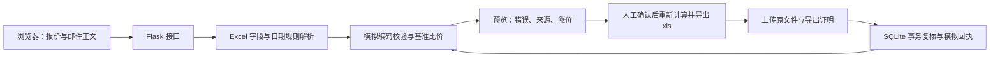

# 系统指南

[返回 README](../README.md) · [接口指南](api.md)

本指南依据当前仓库源码说明2026.11.12演示版。系统负责报价规则解析、人工核对、标准 Excel 导出与模拟导入；没有接入大模型、真实邮箱或真实内部系统。名称中的“智能”不表示已经具备模型理解或自动业务决策能力。

## 1. 系统结构与处理路径



| 文件/目录 | 实际职责 |
| --- | --- |
| `app.py` | Flask 入口、静态页面、健康检查、旧转换接口、统一错误与安全响应头 |
| `static/index.html`、`static/app.js`、`static/style.css` | 配置、示例、预览、确认、下载、导入、编码与基准价维护；页面最多显示前100条预览结果，接口返回全部行 |
| `quote_reader.py` | `.xls/.xlsx` 读取、工作表选择、前20行找表头、字段映射、编码与价格提取 |
| `mail_dates.py` | `.eml/.txt` 正文解析、正则提取日期候选、时区转换；不调用模型 |
| `workflow.py` | 缺失值与异常编码处理、比价、去重、导出、签名证明和文件导入 |
| `demo_api.py`、`mock_store.py` | 会话工作区、供应商/编码/费率/回执、合成示例、SQLite 存储 |
| `converter.py` | 共用数值/编码及 xlsx 安全检查；保留固定表头旧转换流程 |
| `tests/` | 单元/接口测试、HTTP 检查脚本与浏览器流程脚本 |
| `Dockerfile`、`compose.yaml`、`deploy/nginx.conf.example` | 容器运行、持久卷、健康检查与可选 TLS 网关示例 |

前端修改文件或规则后会使旧预览和下载结果失效；服务端导出也重新读取输入，不直接信任前端预览。文件导入使用实际上传内容计算摘要，并在事务中按最新模拟基准重新比价。

## 2. 输入与输出

报价接受真正的 `.xls`（BIFF）或 `.xlsx`；改后缀不会转换格式。多工作表必须指定 `sheet_name` 或在供应商配置中设置工作表名称。系统在选定工作表的前20行匹配必要表头，匹配时忽略大小写并归一空白；映射表头重复会报错。关键编码、费率和日期中的公式或 Excel 错误不能作为有效值，需先在 Excel 中粘贴为值；xls 中检出公式记录会拒绝整个文件。不提供公式计算、PDF/OCR、加密工作簿或任意表格自动理解。

| 输入 | 解释 |
| --- | --- |
| `file` | 报价文件；由供应商 `headers` 决定编码、MT/MO、日期列 |
| 编码 | 支持 MCC/MNC 分列、5/6位合并码、显式 `country_map`；国家报价不能猜运营商 |
| 价格 | 非负有限十进制数，最大10亿，最多12位小数；报价解析另限15位有效数字 |
| `direction` | `mt` 下行/呼出、`mo` 上行/呼入、`both` 双向；后端省略时为 `mt`，页面默认 `both` |
| 邮件 | `.eml`、UTF-8 `.txt` 或粘贴正文；可同时提交文件与文本并合并解析 |
| 日期 | Excel 日期或可解析的日期文本；无时区值按供应商 IANA 时区解释，输出统一 GMT+8 |

MCC 指短信移动国家码，MNC 指移动网络码。标准模拟编码库要求短信 MCC 为100至999的三位文本、MNC 为两位或三位数字文本；语音 CC 为1至3位非零开头数字文本。报价读取层对部分输入更宽松，最终仍须通过模拟字典。请优先按文本保存编码；数字格式能可靠表达的前导零才会还原。

输出为真实 BIFF8 `.xls`，只有 `Sheet1`，第一行固定五列：

| 业务 | 列1 | 列2 | 列3 | 列4 | 列5 |
| --- | --- | --- | --- | --- | --- |
| 短信 | MCC | MNC | 下行费率 | 上行费率 | 生效时间 |
| 语音演示 | CC | MNC | 呼出费率 | 呼入费率 | 生效时间 |

编码写为文本，费率为数值，时间为 Excel 日期且不附时区标记；其约定为 GMT+8。存在涨价的行，两项费率单元格均标黄。币种和计费单位不单列在模板里，必须与供应商配置及业务合同一起核对。文件名分别为 `Template_sendRate_<币种>.xls` 或 `Voice_demo_<币种>.xls`。页面另可下载异常 CSV。

## 3. 实际规则与人工决策

### 价格与方向

- 除数只支持字符串 `"1"` 或 `"100"`。配置的费率表头出现受识别的币种且与配置冲突时拒绝；表头出现 `/100` 而除数不是100时拒绝。这不是对原表全部单位的语义识别。
- `both` 中未配置 MO 或 MO 单元格为空时，上行填0；已配置 MO 表头却找不到该列时拒绝文件。
- **`mt` 模式将上行输出为0，导入会覆盖原上行价。** 下行单向不能理解为只更新下行字段。规范 JSON 导入则可以只提供一个方向，见接口指南。
- `mo` 模式保留目标编码当前下行基准，无基准时阻断；未配置 MO 表头时使用 MT 映射列作为本次上行来源。
- 常规价格不自动换汇。异常编码的约定单价若币种不同，必须显式填写“约定币种→报价币种”的乘数；缺少乘数则阻断。

### 日期

报价表已有非空日期优先，邮件只用于补空值；表内非法日期会阻断，不能靠邮件静默覆盖。邮件发送头、文件名和未映射的普通 `Date` 表头不自动视为生效日。正文按日期格式提取候选，不能判断商业语义，多个日期必须人工选择。

空日期先看 `missing_date_policy`：

| 策略 | 实际处理 |
| --- | --- |
| `skip` | 直接阻断空日期行，即使提交了邮件或手填日期 |
| `manual` | 可用已选邮件候选，其次手填日期；都没有则阻断 |
| `same_file` | 先用已选邮件或手填日期；否则仅在同表有唯一有效非空日期时沿用 |
| `email_then_system` | 先用已选邮件或手填日期；否则沿用目标编码模拟系统已有日期 |

除 `skip` 外，如果邮件存在未选择的日期候选，且没有手填日期，会先阻断，不继续沿用同表或系统日期。`email_date` 必须来自本次提交的正文候选。每行用 `date_source` 和说明标明来源。同表日期和历史日期回填都是可见演示策略，待业务批准。

时间支持明确 UTC 偏移；不带偏移时按供应商时区转换。年份范围1900至2100。夏令时歧义或不存在时段要求填写明确偏移，系统不猜。

### 编码、最高价、去重与比价

- 未知或非数字 MNC 按供应商策略 `skip`、`max` 或 `contract` 处理；非法 MCC、公式等错误不会被替代规则自动修复。
- `max`/`contract` 将目标 MNC 映射为固定模拟值 `999`；模拟字典必须已经存在该 MCC 与999组合。999不是已确认的真实业务约定。
- `max` 仅对异常编码应用本供应商、本文件、同 MCC 的各方向最高价，只比较没有错误的行；不把所有正常重复报价都改成最高价。上下行最高价可来自不同原行。
- `contract` 只影响本次选中方向，默认5 USD仅为约定价情形的演示配置，不能当作实际合同依据。
- 相同目标编码且两方向价格、日期都一致时合并；任一冲突则该组阻断，不按最后一行覆盖。
- 与同供应商、业务、币种的模拟基准比较，任一方向上涨即标记；无基准只说明无法判断涨跌。基准币种不一致时阻断。
- 导出必须确认规则；有可导出涨价行需确认涨价，有阻断行需修正或明确允许部分导出；无可导出行则拒绝。
- 导入前再次确认并事务复核。证明有效期1小时，绑定文件 SHA-256、工作区、供应商、币种、业务；不是对所有配置字段的完整快照，也不是一次性业务审批凭证。重复提交不会自动视为同一业务操作。

## 4. 存储、隐私与限制

原始 Excel、邮件只按请求读取，不作为业务原件落库，不发送外部 AI；本地大请求可能使用系统临时文件。库中保存供应商配置、模拟合法编码、已维护/导入的规范费率及回执。页面输入文件由浏览器持有，刷新后不等于服务端保存了原件。

数据目录由 `VIV_DATA_DIR` 指定，本地默认为仓库下 `.runtime`；容器使用 `/data` 命名卷。目录包含 `mock.sqlite3`、可能存在的 WAL/SHM 文件和 `.session-key`。`VIV_SECRET_KEY` 优先，其次 `SECRET_KEY`，否则使用持久化密钥文件。密钥、数据库、Cookie及验证脚本保存的会话文件均不应公开。

工作区由签名会话 Cookie 定位，不是账号登录。清理 Cookie 会新建工作区，现有界面没有找回入口；仅恢复数据库不能恢复浏览器 Cookie。闲置超过30天的数据在后续访问存储时清理，不是独立定时备份或归档任务。重置接口会清掉当前工作区并重新生成种子数据，不影响其他工作区。

| 限制 | 当前值/行为 |
| --- | --- |
| HTTP请求 | 整体10 MiB；最多24个表单分段，表单内存阈值1 MiB，合规文件也可能因整个请求超限而失败 |
| 报价 | 20,000条；物理行/坐标不超过20,020行、64列；最多20张表 |
| xlsx安全边界 | 解压总量64 MiB；最多1,000个部件；单表16 MiB；共享字符串4 MiB/50,000条；格式表1 MiB |
| xls安全边界 | 工作簿流32 MiB；共享字符串4 MiB/50,000条；检查实际单元格坐标 |
| 邮件 | 文件及合并后的正文分别受512 KiB限制；候选最多返回30个 |
| JSON | 8 MiB；供应商配置另限128 KiB，国家映射最多500项 |
| 存储配额 | 全局200工作区；每区50供应商、20,000编码、50,000费率、200回执；达到上限时报错，不自动淘汰最新记录 |

没有内置账号、角色、业务审批或独立审计系统；Cookie 为 HttpOnly、SameSite=Lax，Secure 随请求协议设置。服务不配置跨源开放，应用也没有以登录或独立令牌做权限校验。只适合有限人员演示；公开部署前应补访问控制并限制网关入口。

## 5. 运行、部署与备份

本地创建环境与启动见 README。依赖以 `requirements.txt` 为准；镜像基于 Python 3.13，不能把镜像版本当作所有 Python 版本均已验证。`python app.py` 是本地开发入口，容器运行 Gunicorn（2进程、各1线程、45秒超时）。

```sh
docker compose up -d --build
docker compose ps
docker compose logs --tail 100 viv-rate-converter
```

Compose 把本机 `127.0.0.1:18041` 映射到容器8000，默认不能从远程直接访问。容器用户10001:10001，根目录只读，`/tmp` 为32 MiB内存盘，限512 MiB内存和1 CPU，日志轮转为5 MiB×2。健康检查只请求 `/health`，通过不代表导出、数据库恢复或真实系统已验收。

公网访问需自行部署 TLS 网关。`deploy/nginx.conf.example` 需要替换示例域名与证书路径；默认上游适用于同主机网关，容器内网关需按实际网络修改。示例对 `/api/` 每来源IP限制60次/分钟、突发20次；429可能来自网关。Compose 的 `VIV_SECURE_COOKIE=1` 开启一层代理协议识别，网关必须覆盖 `X-Forwarded-Proto`，不能原样信任外部输入。

### 停机备份

没有内置备份命令。最小方案是停止所有写入进程，复制完整数据目录，再启动。不要在运行中只复制 `mock.sqlite3` 而漏掉 WAL。备份包含模拟业务数据与密钥，应放在受控且不提交源码的位置。

以下在仓库根目录、容器已建立时执行；`backups/viv-data-snapshot` 必须是本次新目录，已有备份改用新名称。`backups` 仅为本地目录示例：

```sh
python -c "from pathlib import Path; Path('backups').mkdir(exist_ok=True); assert not Path('backups/viv-data-snapshot').exists(), '请换一个新备份目录名'"
docker compose stop viv-rate-converter
docker compose cp viv-rate-converter:/data ./backups/viv-data-snapshot
docker compose start viv-rate-converter
```

逐条检查退出状态；复制失败时先恢复服务并排查，不将其记为备份成功。本地运行则停止服务后复制整个 `VIV_DATA_DIR`。若使用环境变量提供签名密钥，还需在独立安全位置保留相同配置，不能只依赖 `.session-key` 文件。

### 恢复与升级

1. 先备份当前目标环境并停止所有写入；准备空的数据目录/持久卷，避免与旧 WAL 混合。
2. 恢复完整快照，保留实际使用的签名密钥配置；容器数据需由10001:10001可读写。具体卷挂载名由 Compose 项目名决定，不猜固定卷名。
3. 启动后查 `/health`，再用保留原 Cookie 的会话检查供应商、基准价、回执和一次合成报价闭环。数据库快照、密钥、原 Cookie 三者的关系都要核实。
4. 在隔离环境验证恢复后才用于演示环境。现有单元测试不等于完成过本次备份恢复演练。

升级可重新构建并启动，沿用原命名卷。不要使用 `docker compose down -v` 升级；该动作会删除持久卷。仓库没有完整的数据版本迁移和回滚工具，升级前应留可恢复快照。

## 6. 验证命令及证据边界

以下是可执行入口，不表示本次已运行。历史记录为**63项测试，62通过、1跳过**；本次文档工作未重跑套件、启动浏览器、部署服务或进行线上验收。私有原件测试默认跳过，公开仓库不含其输入，也不应把原件加入仓库。

在独立测试数据目录运行，PowerShell 示例：

```powershell
$env:VIV_DATA_DIR = Join-Path $PWD '.agent/tmp/unit-data'
python -m unittest discover -s tests -v
node --check static/app.js
```

Linux/macOS 可用 `VIV_DATA_DIR=.agent/tmp/unit-data python -m unittest discover -s tests -v`。目录只是隔离示例，不应复用有重要数据的目录；运行服务的终端也应设置独立数据目录。

HTTP 流程检查另需 `requests`；对专用演示实例运行，会维护模拟费率并创建回执：

```sh
python -m pip install requests
python tests/verify_system.py --base http://127.0.0.1:18041 --output .agent/tmp/verify-output --state .agent/tmp/verify-state/session.json
```

脚本生成合成 `.xls`、JSON报告和 Cookie文件；验证短信/语音、邮件候选选择、非法输入、涨价确认、导出证明、隔离与查询。完成后重启同一服务，可检查会话与回执持久性：

```sh
python tests/verify_system.py --output .agent/tmp/verify-output --state .agent/tmp/verify-state/session.json --check-persistence
```

浏览器检查另需可解析的 Node.js `playwright` 包及 Chrome：`node tests/browser_workflow.mjs`。可设 `VIV_BASE_URL`、`PLAYWRIGHT_MODULE`、`BROWSER_CHANNEL`；可选 `VIV_SCREENSHOT_DIR` 保存截图。它会操作模拟工作区，并包含拦截请求的页面状态测试，不能替代真实端到端业务验收。`tests/verify_deployment.py` 是旧接口检查，需显式提供 `--base`、`--source`、`--template`、`--out`，不属于无原件公开快速上手。

## 7. 真实业务验收仍缺什么

- 真实内部 API 契约、认证权限、编码主数据、导入/撤回策略和业务环境验证；当前库和回执全部为模拟。
- 授权取得且经脱敏的代表性报价、邮件、标准模板，逐行核对规则、金额、编码、前导零、币种和生效日。
- 国家级报价的映射权限、MNC 999的真实含义、约定价与汇率来源、历史日期回填以及最高价范围的业务批准。
- 腾讯样表币种与计费单位、火山样表计费单位、语音正式导入模板、首次/分段计费周期；当前语音仅五列演示。
- 真实使用规模、访问控制、备份恢复、并发及故障处理验证。本指南记录代码行为，不证明已完成这些验收。
